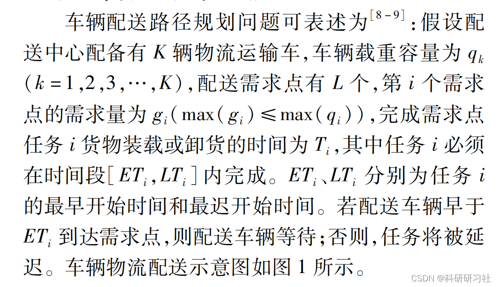
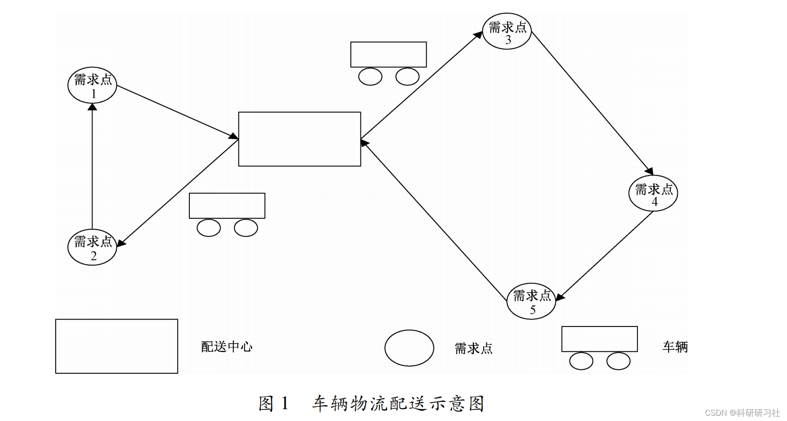
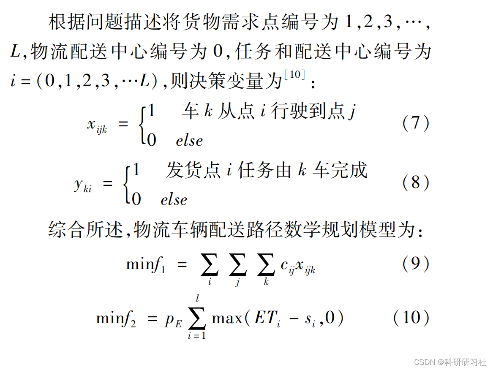
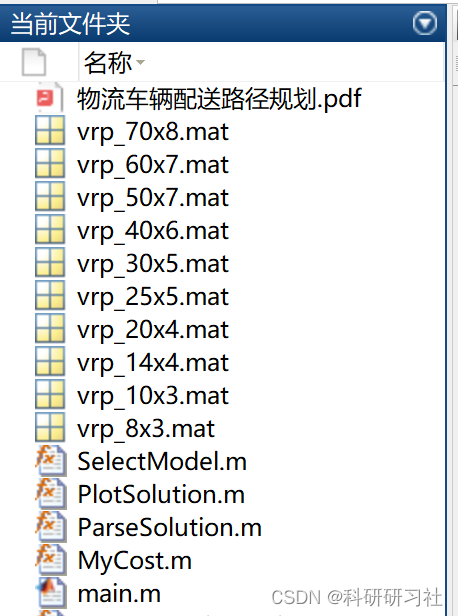
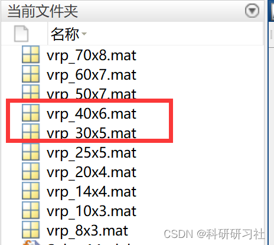
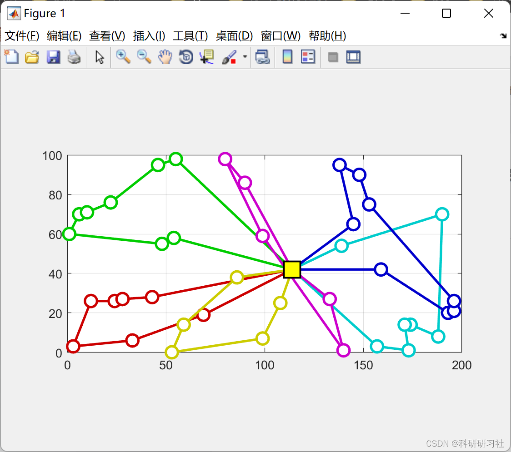
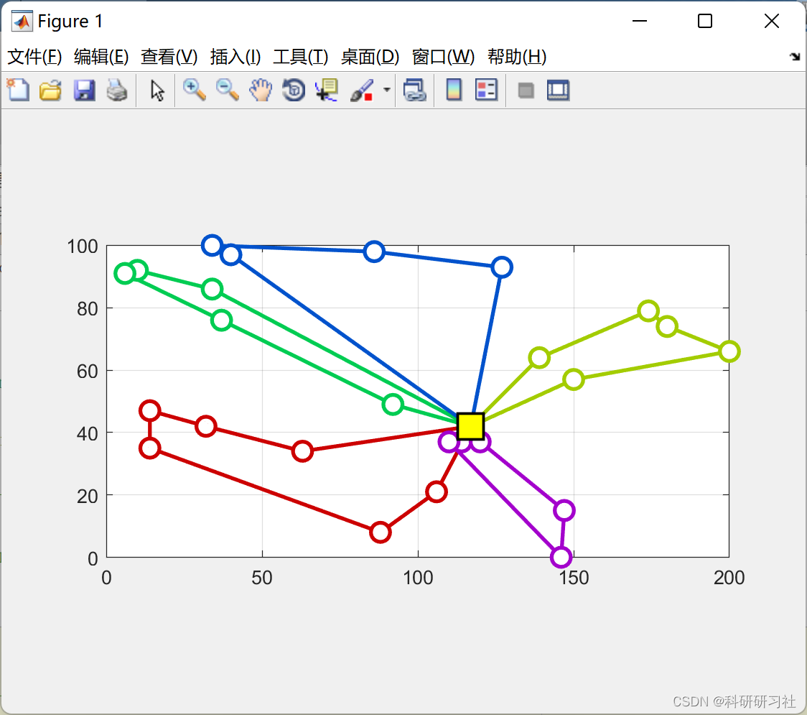
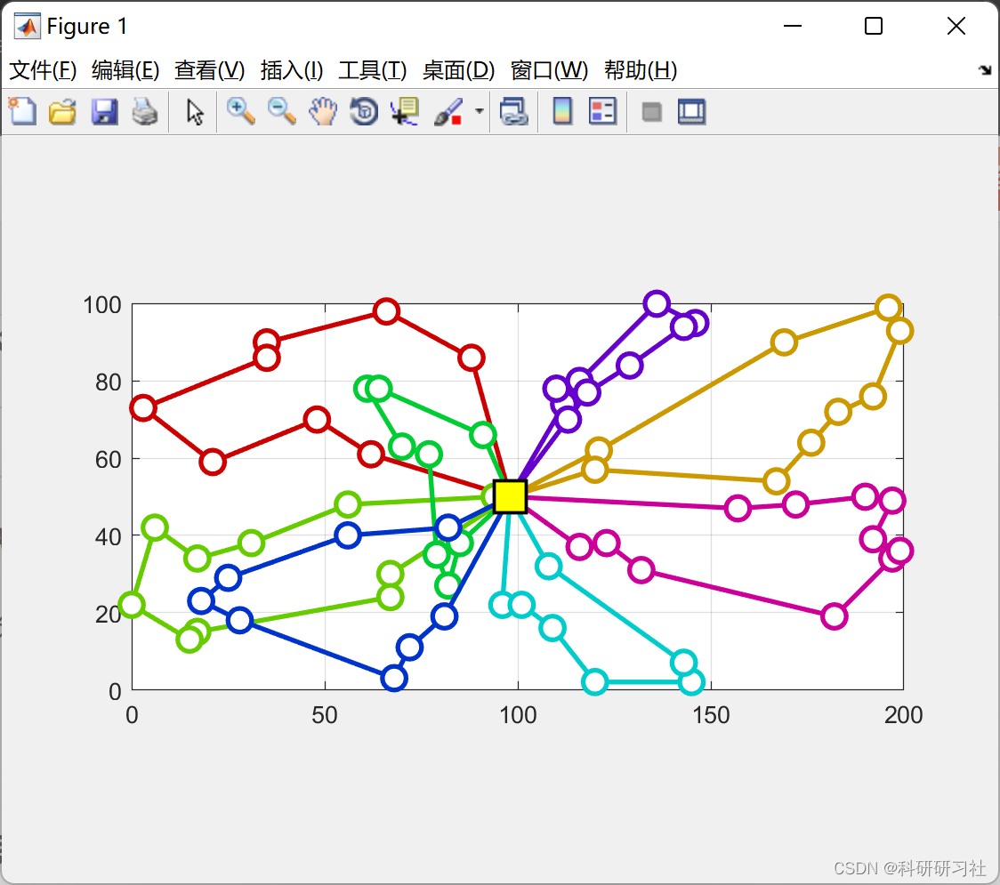
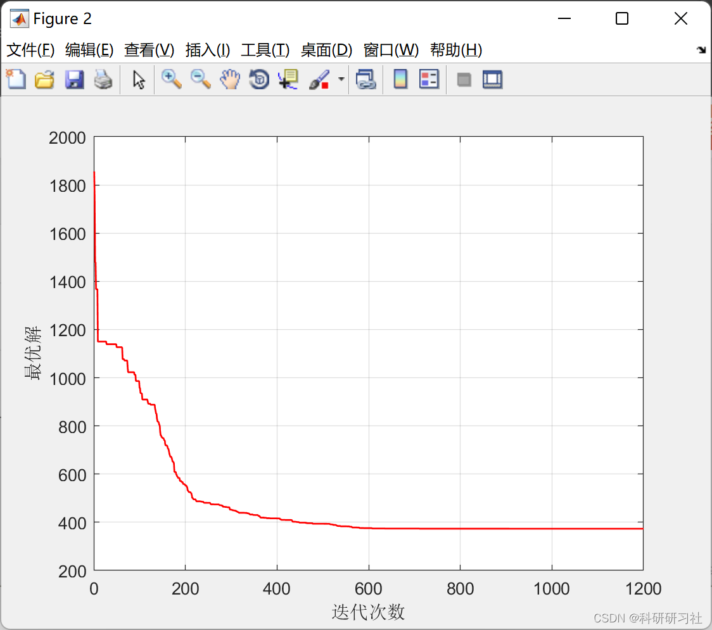
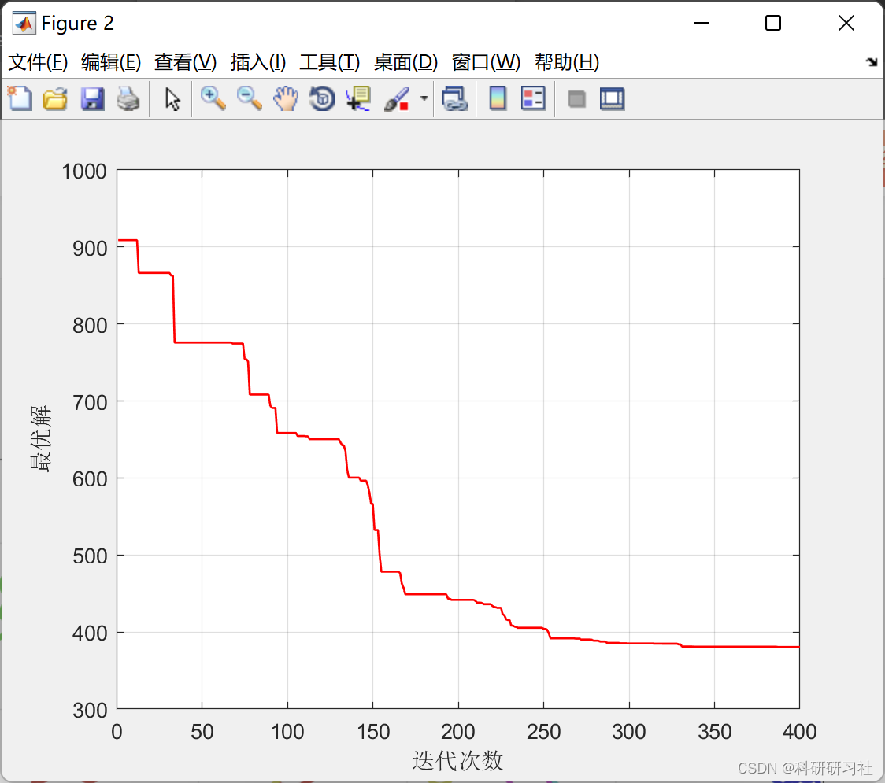

# Simulated Annealing (SA)-based Vehicle Routing Problem (VPR) Solving in Matlab Code

​  
1. Vehicle delivery issues editor
Editor
Editor
In equations (9) to (12), denotes the time at which the delivery vehicle arrives at demand point i; represents the transportation cost from demand point i to demand point j; and are the waiting costs and penalty costs for the delivery vehicle arriving earlier or later than expected at demand point i, respectively. In this mathematical model, each demand point is served by a single logistics vehicle, and each demand point can only be transported by one logistics vehicle. At the same time, the total demand at all demand points on the same delivery route should not exceed the maximum load capacity of the logistics vehicle.
2 Simulated Annealing Method - Intelligent Optimization Algorithm - Simulated Annealing Method (Python & MATLAB implementation)
3. MATLAB code implementation: This document only showcases a portion of the code, all codes can be downloaded by clicking the link:
Vehicle routing problem (VPR) solved by Simulated Annealing (SA) in Matlab code implementation
Editor
function CreateAndSaveModels()\n\n    I=[8 10 14 20 25 30 40 50 60 70];\n    J=[3  3  4  4  5  5  6  7  7  8];\n    \n    nModel=numel(I);\n    \n    for k=1:nModel\n        \n        model=CreateRandomModel(I(k),J(k));\n        \n        ModelName=['vrp_' num2str(model.I) 'x' num2str(model.J)];\n        \n        save(ModelName,'model');\n        \n    end\n\nend\n  
4. Implementation results: Here, only the running results of two are displayed:
Editing
Editing
Editing
Editing
Editing
Editing

## Images

<!-- PAYMENT_BLOCK -->

## Get this dataset

- Payment link (Stripe): [Buy now](https://buy.stripe.com/3cs8yP7sY87d0vu9AB)
- Payment QR code: 

<!-- /PAYMENT_BLOCK -->
